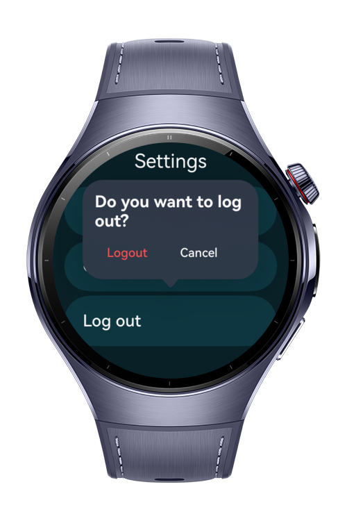

> **Note:** To access all shared projects, get information about environment setup, and view other guides, please visit [Explore-In-HMOS-Wearable Index](https://github.com/Explore-In-HMOS-Wearable/hmos-index).

# How to Build Popup Tooltip?

A lightweight popup & tooltip pattern library for HarmonyOS (ArkUI), built for wearables / smart watches.
Attach bubble-style popups and tooltips to any component, with arrow pointing, action buttons, and a shared controller for managing visibility.

# Preview

<div>
 
  
</div>

# Use Cases

- Popup bubble popups on tap, with icon, title, text, and action buttons.
- Tooltip lightweight text tooltips on long-press, auto-dismiss after a set duration.
- Shared controller one PopupController to show / hide / toggle.
- Attach to anything wrap any component via a trailing closure.

# Technology

## Stack

- **Languages**: ArkTS
- **Frameworks**: HarmonyOS SDK 5.1.0(21)
- **Tools**: DevEco Studio Vers 6.0.1.251
- **Libraries**: @kit.ArkUI

# Directory Structure

   ```
├── entry/
│   └── src/main/
│       └── ets/
│           ├── entryability/EntryAbility.ets
│           ├── entrybackupability/EntryBackupAbility.ets
│           └── pages/Index.ets
└── popup_tooltip_lib/
    ├── Index.ets
    ├── oh-package.json5
    ├── README.md
    └── src/main/
        └── ets/components/
            ├── PopupTypes.ets
            ├── PopupController.ets
            ├── PopupContentView.ets
            ├── PopupHost.ets
            └── TooltipHost.ets
   ```

# Constraints and Restrictions

## Supported Devices

- Huawei Watch 5
- DevEco Studio Simulator

# License

**How to Build Popup Tooltip?** is distributed under the terms of the MIT License
See the [LICENSE](./LICENSE) for more information.